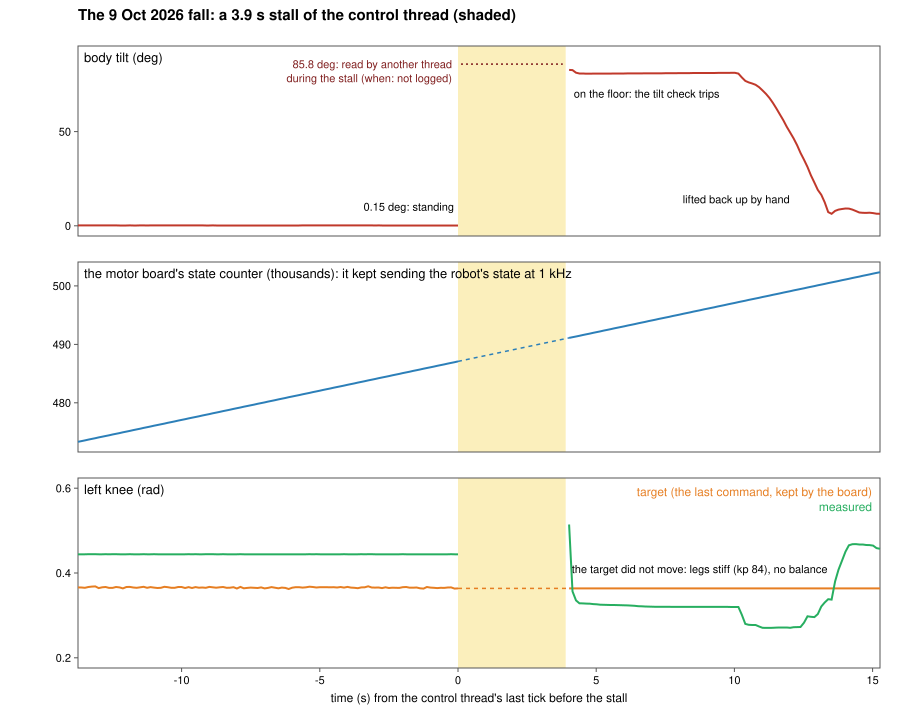

# Case study: a 4-second software stall, and why r1mc3 is built the way it is

On 9 Oct 2026 our R1 fell over while standing still. Nothing hit it and the motors, the network cable and the robot's
own computer were fine: the program that balanced it stopped running for 3.9 seconds. This page shows what the logs
say, what caused the stall, why the robot did not simply go limp or keep balancing, and what r1mc3 - the controller in
this repository - does differently because of it.

Data: [`data/v2_fall_telemetry.csv`](data/v2_fall_telemetry.csv) - the controller's own telemetry for 30 s around the
stall (8 rows per second; `t_s` = seconds from the last row before the stall; the body tilt, the motor board's state
counter, every leg joint's target and measured angle, the leg stiffness, the gait phase, the IMU quaternion).

## The setup

The robot ran our previous controller (r1mc2), a single Python process on the backpack computer. One thread, the
control thread, did everything that keeps the robot standing, 200 times a second: read the robot's state, run the
balance policy (the same network r1mc3 runs today, `docs/POLICY.md`), check the tilt, send the joint commands. Every 25
ticks the same thread also wrote a telemetry row - and to fill that row it read the network link's health from Linux
(`/sys/class/net/<interface>/speed`, for the USB network adapter that carries the motor traffic).

The robot was standing in place (the policy's zero-speed command), its left arm raised beside a table by a scripted
motion that had just finished; the hands were holding still. Nothing new had been commanded for about 20 s.

## What the logs show

| Time (s) | What |
|---|---|
| -13.8 .. 0 | normal: 8 telemetry rows a second, tilt 0.15-0.2 deg, the gait phase advancing (the policy runs) |
| 0 | the last row the control thread wrote |
| 0 .. 3.9 | **no rows**: the control thread did not run. The policy did not step once (the gait phase reads 0.221 before and after). The tilt check did not run. |
| end of the stall | another thread of the same process printed its regular status line: **tilt 85.8 deg** - the robot was already on the floor. That thread reads the same link-health files; as far as the logs tell, it got through just before the control thread came back |
| during the stall | the motor board kept sending the robot's state: its counter advanced 4,018 in 4.02 s (1 kHz). The wired link to the motors never dropped. |
| 3.9 | the control thread runs again; its first tick finds the tilt at 83 deg and stops everything |
| 3.9 .. 10 | the legs' targets are the ones from before the stall to four decimals, at full stiffness (kp 84 N m/rad): the robot lies on the floor with its legs held stiff |

Two more facts narrow it down. The timed part of each tick (read the state, the policy, the checks, the write) never
took more than 9.3 ms, before or after - so the 3.9 s were spent outside it, in the telemetry step. And the process
was alive: other threads ran during the stall, only the control thread was stuck.

## The cause

Reading a network interface's `speed` in Linux takes the kernel's network configuration lock (rtnl) and, for a USB
network adapter, talks to the adapter over USB. The backpack's Wi-Fi was a USB dongle on the same USB controller.
When Wi-Fi drops and reconnects, the network services hold that same kernel lock while they reconfigure the interface,
and the dongle's driver is known to hold it for seconds. A Wi-Fi drop was seen at the time of the fall.

**Confirmed on the robot two days later** (robot hanging on its stand, nothing balancing): the `speed` read normally
takes 8.6 ms; right after the Wi-Fi came back it took **3.80 s and 3.89 s** - the length of the stall. Other
explanations were considered and ranked lower: the telemetry file write on a disk with file-system errors, and a
Python thread holding the interpreter lock (it would have stopped the other thread too, which kept printing).

The deeper flaw does not depend on which call blocked: **balance, safety checks and slow I/O shared one thread, and
that thread could block.** The previous sessions had no long stalls because the kernel had not been slow yet, not
because the design was safe.

## Why the board kept the old targets

The R1's motor board does not run the balance; it applies the last command it received - a target angle, a stiffness
and a damping per joint. When the control thread stopped, no new command came, and nothing in the robot computed
the next one. On that day the board kept holding the last targets at full stiffness for the whole stall: the measured
knee angles after the fall stay near their targets (0.51 / 0.47 rad), while a board that lets go folds the knees
(about 2.4 rad in our simulator's replay of the fall). A stiff robot that nobody balances is a statue on two small
feet; a small sway is enough to tip it.

Later, on the stand, we measured what the board does when the commands stop altogether: it holds the last command for
**~0.385 s, then damps** (zero stiffness, damping ~12.5 N m s/rad) - the arms start to sink. Why it held for four
seconds on 9 Oct is not settled (a different control mode, the robot standing instead of hanging, or a difference in
the board's state that day). Either way - holding or damping - nothing balances the robot once its controller stops,
and with a balancing humanoid that means a fall within about a second (our simulator: a whole-controller stall of 1 s
is ridden out with a 9-19 deg sway, 2 s falls).

## What r1mc3 does differently

| The lesson | r1mc3 |
|---|---|
| Never let anything slow share the thread that balances | **`r1rt`, a small C++ real-time core**, is the only process that talks to the motors. Its 500 Hz writer does no file or network I/O, no memory allocation, no locks shared with other threads, no Python. Telemetry leaves through lock-free shared-memory rings; a separate logger process writes the files; link health, cameras, planning and the API live in other processes |
| A stall must not stop the balance | **`r1guard`, an independent hot-standby process**, watches the core's heartbeat and takes the motors over, balancing in place, when the core goes quiet: on the robot it started commanding **~10.5 ms** after the core was paused (both test runs, `docs/DATASET.md`). One writer at a time, enforced by an ownership token in shared memory |
| Never limp, never stale | **The fallback ladder is: the policy inline -> the guard takes over -> stand-and-freeze. Nothing automatic ever damps the robot**; damping is an operator command. The core drops a command older than 5 ms instead of sending it; after a long silence on the stand it blends back from the measured pose instead of snapping to the old targets |
| The safety check must not depend on the thread it protects | the tilt, state-age and fault checks run inside the core's writer every tick; the guard runs its own |
| Make the next stall diagnosable | full-rate telemetry at the writer's tick, per-iteration timing (`wake_lateness_ns`, `iteration_ns`), a flight recorder that saves the seconds around every fault |

In simulation, with the same stall injected into the real controller processes, the previous design falls and r1mc3
stays up (the guard takes over); on the robot, two real Wi-Fi drops and three dongle resets during the stand session
never touched r1mc3's command stream (500 commands a second, every second).

## For anyone writing a robot controller

1. Find every call on your control loop that can block - file writes, logging, network or device status reads, locks
   shared with other threads, memory allocation, the interpreter lock. Assume each one will, one day, for seconds.
2. A "harmless" status read can take a kernel-wide lock. `/sys` and `/proc` reads are system calls, not memory reads.
3. Time the whole loop iteration, not only the part you think does the work: our per-tick timer was blind to the 3.9 s.
4. Decide what your motors do when your commands stop, measure it on your robot, and do not rely on it: a watchdog that
   lives in a separate process (and ideally a separate priority) is the only thing that keeps balancing.
